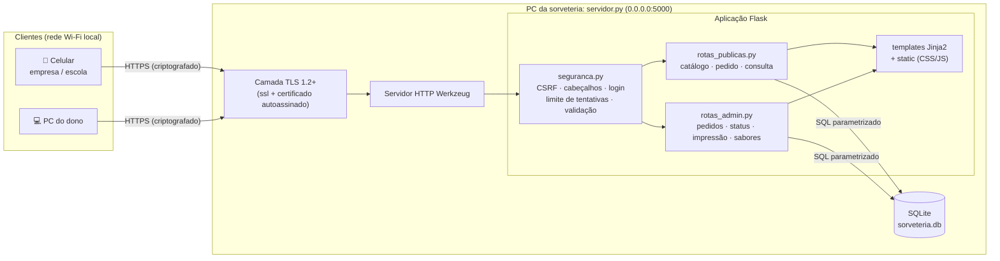
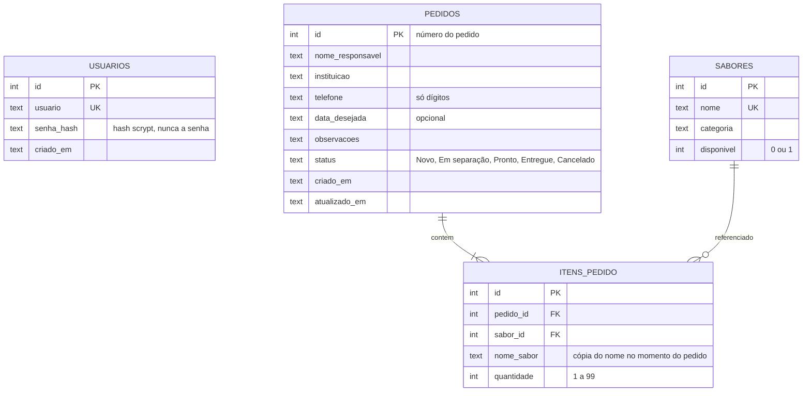
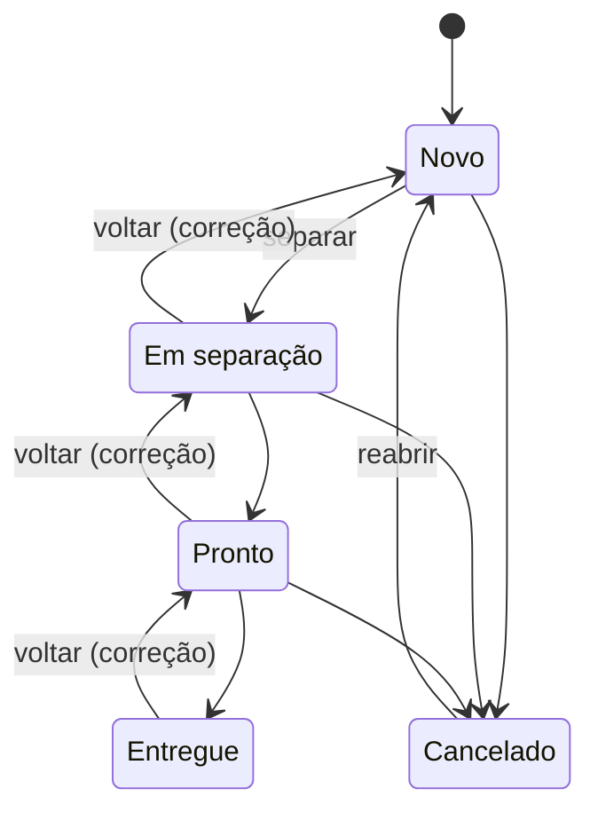
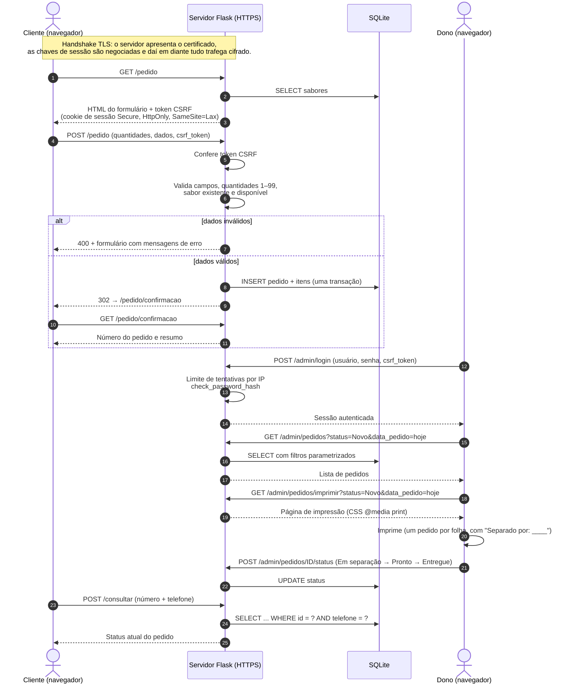

# Arquitetura: sistema de pedidos da Frutos de Goiás

## 1. Visão geral

O sistema segue o modelo **cliente-servidor** clássico da web:

- **Cliente:** o navegador (celular ou PC) do comprador ou do dono. Ele só exibe páginas HTML e
  envia formulários. Nenhuma regra de negócio depende do navegador.
- **Servidor:** uma aplicação Python/Flask que recebe as requisições HTTP **dentro de um túnel
  TLS (HTTPS)**, valida os dados, consulta e grava no banco SQLite e devolve o HTML pronto
  (renderização no servidor com Jinja2).
- **Banco de dados:** um arquivo SQLite acessado pelo módulo `sqlite3`, sempre com consultas
  parametrizadas.

### Camadas e módulos

| Módulo | Responsabilidade |
|---|---|
| `servidor.py` | Cria o contexto TLS (`ssl.SSLContext`, mínimo TLS 1.2), carrega o certificado e inicia o servidor em `0.0.0.0` |
| `gerar_certificado.py` | Gera chave RSA 2048 e certificado X.509 autoassinado (SHA-256) com SAN para `localhost`, `127.0.0.1` e IP da rede |
| `app/__init__.py` | Fábrica da aplicação: lê o `.env`, configura cookies e CSRF, registra rotas, erros e o comando `flask criar-admin` |
| `app/seguranca.py` | Cabeçalhos HTTP de segurança, decorador `login_obrigatorio`, limitador de tentativas, validação das entradas |
| `app/rotas_publicas.py` | Rotas abertas ao público |
| `app/rotas_admin.py` | Rotas da área do dono (exigem login) |
| `app/db.py` + `schema.sql` | Conexão por requisição e criação das tabelas |
| `seed.py` | Carga inicial dos sabores |

### Modelo de dados

O nome do sabor é **copiado** para `itens_pedido`. Assim, se o dono renomear um sabor depois, os
pedidos antigos e as impressões continuam mostrando o nome original.

---

## 2. Rotas

### Área pública

| Método | Rota | Descrição |
|---|---|---|
| GET | `/` | Catálogo agrupado por categoria. `?q=` busca por nome, sem diferenciar acentos. Indisponíveis aparecem esmaecidos |
| GET | `/pedido` | Formulário de pedido: quantidade por sabor disponível e dados do cliente |
| POST | `/pedido` | Valida e grava o pedido; redireciona para a confirmação (padrão POST-Redirect-GET) |
| GET | `/pedido/confirmacao` | Número e resumo do pedido recém-feito. O número vem da sessão, não da URL |
| GET | `/consultar` | Formulário "Consultar meu pedido" |
| POST | `/consultar` | Número + telefone → status e itens, sem nome nem telefone na resposta |

### Área do dono (prefixo `/admin`)

| Método | Rota | Login | Descrição |
|---|---|---|---|
| GET/POST | `/admin/login` | não | Tela e verificação de login (com limite de tentativas) |
| POST | `/admin/logout` | sim | Encerra a sessão |
| GET | `/admin/` | sim | Redireciona para a lista de pedidos |
| GET | `/admin/pedidos` | sim | Lista (mais recentes primeiro) com filtros `status`, `data_pedido`, `data_retirada`, `instituicao` |
| GET | `/admin/pedidos/<id>` | sim | Detalhe do pedido e botões de status |
| POST | `/admin/pedidos/<id>/status` | sim | Muda o status (só transições permitidas) |
| GET | `/admin/pedidos/<id>/imprimir` | sim | Folha de impressão de um pedido |
| GET | `/admin/pedidos/imprimir?filtros` | sim | Folhas de todos os pedidos filtrados (um por página) |
| GET | `/admin/sabores` | sim | Lista de sabores e formulário para adicionar |
| POST | `/admin/sabores` | sim | Adiciona um sabor |
| GET/POST | `/admin/sabores/<id>/editar` | sim | Edita nome e categoria |
| POST | `/admin/sabores/<id>/disponibilidade` | sim | Alterna disponível/indisponível |

Toda ação que **altera dados** usa POST e exige token CSRF. As rotas GET apenas consultam.

### Transições de status

O servidor recusa qualquer outra transição, como pular de "Novo" direto para "Entregue".

---

## 3. Fluxo de um pedido: do cliente até a impressão

---

## 4. Mecanismos de segurança

A tabela resume os mecanismos. Cada um é detalhado em seguida.

| # | Mecanismo | Ameaça combatida | Onde está |
|---|---|---|---|
| 1 | HTTPS/TLS 1.2+ | Espionagem e alteração dos dados na rede (Wi-Fi) | `servidor.py`, `gerar_certificado.py` |
| 2 | Segredos no `.env` | Vazamento de chaves pelo código-fonte | `.env`, `app/__init__.py` |
| 3 | Senha com hash | Vazamento do banco expor senhas | `rotas_admin.py`, comando `criar-admin` |
| 4 | Sessão com cookie seguro | Roubo de sessão, CSRF | `app/__init__.py` |
| 5 | Proteção CSRF | Site externo enviar formulários em nome do usuário | Flask-WTF, todos os formulários |
| 6 | Limite de tentativas | Adivinhação de senha (força bruta) | `seguranca.py`, `rotas_admin.py`, `rotas_publicas.py` |
| 7 | Validação no servidor | Dados inválidos ou manipulados | `seguranca.py`, rotas |
| 8 | SQL parametrizado | Injeção de SQL | todas as consultas |
| 9 | Escape automático de HTML + CSP | XSS (injeção de scripts) | Jinja2, `seguranca.py` |
| 10 | Cabeçalhos de segurança | Clickjacking, MIME sniffing, cache | `seguranca.py` |
| 11 | Controle de acesso e privacidade | Acesso indevido a dados de clientes | `login_obrigatorio`, consulta pública |

### 4.1 HTTPS/TLS: comunicação criptografada

**Por quê:** os clientes usam o site pelo Wi-Fi. Em HTTP puro, qualquer pessoa na mesma rede
poderia ler (ou alterar) o que trafega: senha do dono, nome e telefone dos clientes, cookie de
sessão. Com TLS, os dados são cifrados entre o navegador e o servidor.

**Como:**

- `gerar_certificado.py` usa a biblioteca **cryptography** para gerar uma chave **RSA de 2048
  bits** e um certificado **X.509 assinado com SHA-256**, válido por 365 dias.
- O certificado traz a extensão **SAN (Subject Alternative Name)** com `localhost`, `127.0.0.1` e
  o IP da rede local informado por `--ip`. Os navegadores modernos conferem o endereço pelo SAN,
  então sem ele o acesso pelo celular falharia mesmo depois de aceitar o aviso.
- `servidor.py` cria um `ssl.SSLContext(PROTOCOL_TLS_SERVER)` do módulo **`ssl`** da biblioteca
  padrão, define `minimum_version = TLSv1_2` (SSLv3, TLS 1.0 e 1.1 têm falhas conhecidas) e passa
  o contexto para o servidor via `ssl_context`.
- No handshake, o servidor apresenta o certificado e as chaves de sessão são negociadas por troca
  de chaves com sigilo futuro (ECDHE). O conteúdo segue cifrado com algoritmos autenticados, como
  AES-GCM ou ChaCha20-Poly1305, escolhidos pela biblioteca OpenSSL.

**Limitação, documentada de propósito:** o certificado é **autoassinado**, então o navegador não
consegue verificar a *identidade* do servidor e mostra um aviso. A *criptografia* funciona
normalmente. Em produção, o certificado seria emitido por uma autoridade (ex.: Let's Encrypt).
Pelo mesmo motivo, **não** enviamos o cabeçalho HSTS: com certificado autoassinado, ele poderia
travar o acesso ao `localhost` no navegador.

### 4.2 Segredos fora do código (`.env`)

A `SECRET_KEY` assina o cookie de sessão e os tokens CSRF. Quem a conhece consegue forjar uma
sessão de dono. Por isso ela fica no arquivo `.env`, carregado com **python-dotenv**, e esse
arquivo está no `.gitignore`. O repositório contém só o `.env.example`. A aplicação **se recusa a
iniciar** sem uma chave própria, inclusive se o valor de exemplo não for trocado. A pasta `certs/`
(que contém a chave privada TLS) e o banco `*.db` também ficam fora do git.

### 4.3 Senhas guardadas apenas como hash

O comando `flask criar-admin` pede a senha no terminal (sem exibi-la e com confirmação) e grava só
o resultado de `werkzeug.security.generate_password_hash`, que usa **scrypt** com **salt
aleatório**. No login, `check_password_hash` refaz o cálculo e compara em tempo constante. Mesmo
que o arquivo do banco vaze, as senhas não aparecem.

Não existe senha fixa no código. Quando o usuário digitado **não existe**, o servidor compara a
senha com um hash fictício. Assim o tempo de resposta é parecido nos dois casos e a mensagem é
sempre a mesma ("Usuário ou senha incorretos"), o que impede descobrir quais usuários existem.

### 4.4 Cookie de sessão seguro

A sessão do Flask é um cookie **assinado** com a `SECRET_KEY`. Ele está configurado com:

- **`Secure`**: só trafega por HTTPS.
- **`HttpOnly`**: JavaScript da página não consegue lê-lo. Mesmo um eventual XSS não rouba a sessão.
- **`SameSite=Lax`**: o navegador não envia o cookie em POSTs vindos de outros sites (defesa
  extra contra CSRF).
- **Expiração** de 8 horas após o login.

No login, a sessão anterior é **descartada** (`session.clear()`) antes de gravar o usuário, o que
evita fixação de sessão. O logout é um POST com CSRF, para que um link externo não consiga
deslogar o dono.

### 4.5 Proteção CSRF (Flask-WTF)

*Cross-Site Request Forgery* acontece quando um site malicioso faz o navegador do dono, que já
está logado, enviar um formulário para o nosso servidor (por exemplo, cancelar pedidos). O
`CSRFProtect` do **Flask-WTF** exige, em **todo** POST, um token secreto ligado à sessão e
inserido como campo oculto nos formulários. Um site externo não consegue ler esse token, então
a requisição forjada é recusada com **400 "Formulário expirado"**. Os testes verificam POST sem
token, com token falso e com token de outra sessão.

### 4.6 Limite de tentativas

`LimitadorTentativas` (em `seguranca.py`) guarda em memória, por endereço IP, os horários das
falhas recentes:

- **Login:** 5 falhas em 5 minutos bloqueiam o IP por **5 minutos** (HTTP 429). Durante o bloqueio,
  até a senha correta é recusada. Um login bem-sucedido zera o contador.
- **Consulta pública de pedido:** 10 falhas bloqueiam por 5 minutos. Isso dificulta "chutar"
  telefones para descobrir o status de pedidos alheios.

Os contadores usam um `threading.Lock`, porque o servidor atende requisições em várias threads.
Como ficam em memória, reiniciar o servidor zera tudo. Para um único servidor local isso é
suficiente e evita dependências extras.

### 4.7 Validação no servidor

O HTML tem `required`, `maxlength` e `min/max`, mas isso é só conforto: qualquer pessoa pode
alterar a página ou enviar requisições direto. **Toda** validação é refeita no servidor
(`validar_pedido`, `validar_sabor`, `ler_filtros`):

- Nome do responsável (obrigatório, até 100), instituição (obrigatória, até 120), observações
  (até 300). Caracteres de controle são removidos.
- Telefone: normalizado para dígitos (aceita `+55` e zero inicial); exige 10 ou 11 dígitos.
- Data desejada: formato de data válido e não pode estar no passado.
- Quantidade: **apenas dígitos, inteiro de 1 a 99**. Recusa `1.5`, `-1`, `1e2`, `abc`, `100`.
- Sabor: precisa **existir** e estar **disponível** no momento do envio. Um sabor marcado como
  indisponível nem aparece como campo no formulário, e mesmo que alguém o injete no POST ele é
  recusado.
- Pelo menos um item por pedido; pedido e itens são gravados numa **transação única**.
- Filtros do admin: status só da lista oficial e datas em formato ISO; valores inválidos são
  ignorados.
- Corpo das requisições limitado a 64 KB (`MAX_CONTENT_LENGTH`).
- Parâmetro `next` do login aceita só caminhos internos `/admin/...`, o que evita *open redirect*.

### 4.8 Consultas SQL parametrizadas

Todas as consultas usam marcadores `?` e passam os valores separadamente para o `sqlite3`. O texto
do usuário **nunca** é concatenado no SQL, então um valor como `' OR 1=1; DROP TABLE pedidos; --`
é tratado só como texto. O filtro por instituição usa `LIKE ? ESCAPE '\'` e escapa `%` e `_`.
Há um teste que envia esse ataque e confere que a tabela continua intacta.

### 4.9 XSS: escape automático e Content-Security-Policy

- O Jinja2 **escapa automaticamente** todo valor exibido: um nome como `<script>` vira
  `&lt;script&gt;` e aparece como texto. Há um teste que verifica isso.
- O cabeçalho **Content-Security-Policy** (`default-src 'self'; script-src 'self'; ...`) só
  permite carregar scripts, estilos e imagens do próprio servidor e **proíbe scripts embutidos**
  no HTML. Por isso o pouco JavaScript do projeto fica em `static/js/app.js`.

### 4.10 Cabeçalhos de segurança

Adicionados a toda resposta por `aplicar_cabecalhos`:

| Cabeçalho | Valor | Efeito |
|---|---|---|
| `Content-Security-Policy` | ver 4.9, com `frame-ancestors 'none'` e `form-action 'self'` | limita origens de conteúdo; formulários só enviam para o próprio site |
| `X-Content-Type-Options` | `nosniff` | o navegador não "adivinha" o tipo de arquivo |
| `X-Frame-Options` | `DENY` | o site não pode ser aberto dentro de um iframe (clickjacking) |
| `Referrer-Policy` | `same-origin` | o endereço das páginas não vaza para outros sites |
| `Cache-Control` | `no-store` (só em `/admin`) | dados de clientes não ficam no cache do navegador |

### 4.11 Controle de acesso e privacidade dos clientes

- Todas as rotas `/admin/*` (exceto o login) usam o decorador `@login_obrigatorio`. Sem sessão
  válida, o usuário é redirecionado para o login.
- **Nome e telefone** dos clientes só aparecem na área logada e na tela de confirmação mostrada ao
  próprio cliente logo após o envio. O número do pedido dessa tela vem da sessão, então trocar o
  número na URL não mostra o pedido de outra pessoa.
- A **consulta pública** exige número **e** telefone, mostra apenas status, datas e itens, e
  responde com a mesma mensagem genérica quando o número não existe ou o telefone não confere.
- O servidor roda com `debug=False`. O modo debug do Flask permite executar código pelo navegador
  e nunca deve ficar ativo numa rede compartilhada.

### 4.12 Limitações conhecidas (fora do escopo)

- Certificado autoassinado (ver 4.1).
- Limitador de tentativas em memória: zera ao reiniciar e considera o IP. Se todos acessarem por
  trás do mesmo roteador com NAT, eles compartilham o contador.
- O servidor embutido do Werkzeug atende bem a demonstração local e o volume de uma sorveteria.
  Numa hospedagem pública, o recomendado seria um servidor WSGI (ex.: Waitress) atrás de um proxy
  reverso com certificado válido.
- Não há registro (log) de auditoria de quem mudou cada status. Como só os donos acessam, isso
  foi considerado complexidade desnecessária para esta versão.
